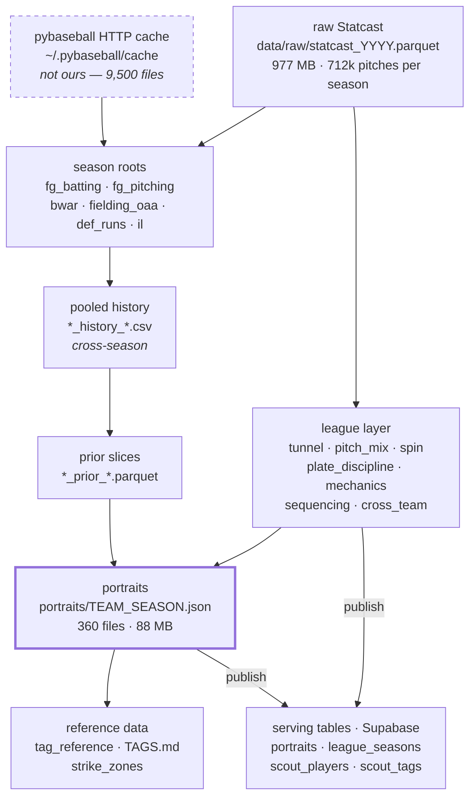
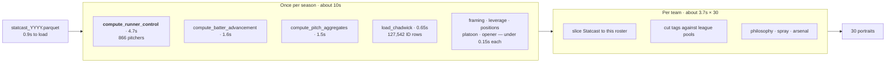
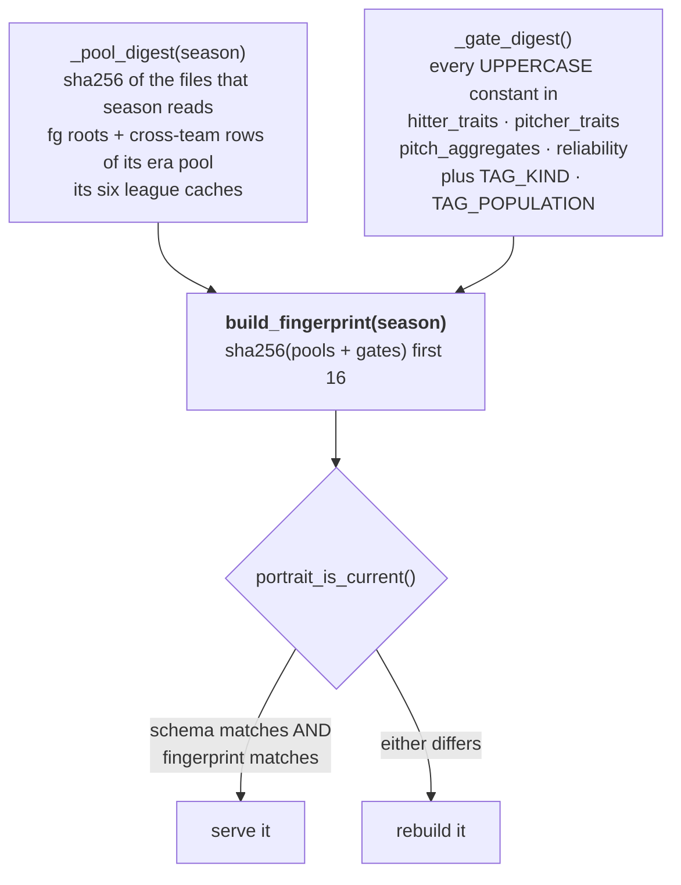
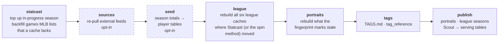
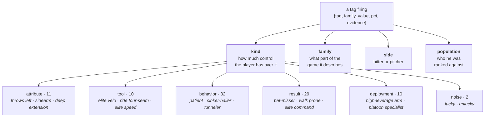
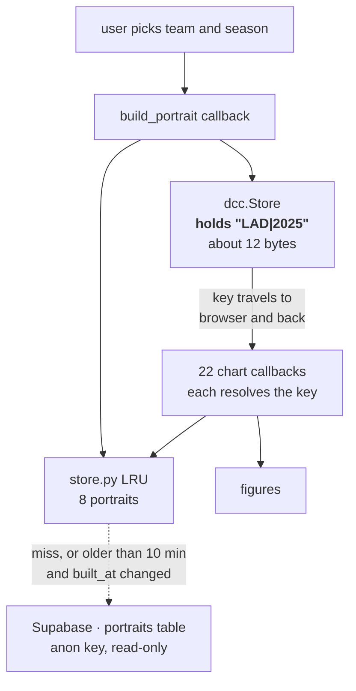
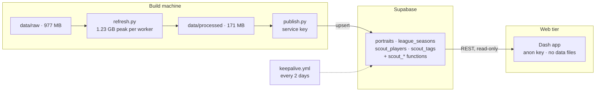

# Architecture

How data gets from Baseball Savant to a chart on screen, and why it is shaped
this way. For the runbook see [OPERATIONS.md](OPERATIONS.md); for the reasoning
behind specific choices see [DECISIONS.md](DECISIONS.md).

---

## The one-sentence version

Raw pitch data is boiled down, once, into a 239 KB JSON **portrait** per
team-season; the dashboard only ever reads portraits.

That split is the whole design. Building a portrait touches ~1.2 GB of
pitch-level Statcast. Serving one costs 200 MB of RAM and no raw data at all.
Everything below follows from keeping those two jobs apart.

---

## The cache stack

Five layers, and the outermost one is not ours. Each is derived from the one
above, which is why a stale layer higher up silently poisons everything below.

**The trap this causes.** Purging a middle layer rebuilds it from a stale root
and changes nothing. `repair_metric_units.py` sprang this twice before the
lesson stuck: repairing the database is not enough, because `team_portrait`
ranks players against pools cached on disk that keep whatever units they were
built with.

**The layer that is not ours.** `pybaseball` keeps its own HTTP cache, enabled
globally. Deleting our CSV and calling the puller again only reaches layer two
— pybaseball answers from its own store and writes back identical numbers. A
`sources` refresh once reported "6 refreshed, 0 failed" while changing nothing.
`refresh.py` now disables that cache for the duration of the stage.

---

## Building a portrait

`team_portrait.build_team_portrait(team, season)` runs 18 steps, but they split
into two kinds of work with very different costs.

Measured on 2025: first team 16.3s, every team after 3.6–4.4s. The league-wide
layer is memoised **in-process only**, so a fresh process pays for it again —
which is why a full 12-season rebuild is about 20 minutes rather than 2.

The team-specific work is irreducible. The league-wide work is a function of
that season's Statcast alone and, for a finished season, can never change.

---

## Staleness: the build fingerprint

A portrait is safe to serve only if it was built from the current data **and**
the current tag logic. Schema version alone cannot tell you that — it detects a
change of *shape*, and units or thresholds changing is a change of *content* at
the same shape. Thirty-one portraits once carried the current schema and
pre-repair units, and were served as valid cache hits.

**Two halves, because only builders have the pools.** The pool files are
build-time data and exist only on the machine that builds portraits, so only
that machine can compute `build_fingerprint()`. Portraits therefore also carry
`gate_fingerprint`, the gate digest alone, which any machine with the code can
compute. The builders (`refresh.py`, `build_league_identity.py`,
`rederive_traits.py`) and `publish.py` check the full fingerprint, and publish
refuses any portrait that fails it. The dashboard checks only the gate half: it
reads a published row only when `schema_version` and `gate_fingerprint` match
the code it is running, so tag logic deployed over older portraits shows "being
replaced" rather than old tags under new rules.

**Three gaps this had, all now closed.** `tunnel_league_*.parquet` and
`spin_league_*.parquet` live in `modules/processed`, outside the glob, so
tunnelling and spin changes could not move the fingerprint. And `pitch_aggregates` was absent from the gate digest despite
owning the strike-zone geometry behind zone%, chase%, CSW% and framing — so a
zone constant could change tag output invisibly.

**Per season, so a night of games re-ranks one season.** The fingerprint used
to hash every pool file of every season, so topping up 2026 marked all 360
portraits stale — 2015 included. Now each season hashes only what its portraits
read: the `fg_batting`/`fg_pitching` roots of the seasons in its era pool, and
its own six league caches — tunnel, pitch mix, spin, plate discipline,
mechanics, sequencing. Tunnel and spin had stages of their own; pitch mix,
plate discipline, mechanics and sequencing had none and were not hashed, and
2026's sat 92.8 days behind the raw file while every portrait read as
current. One `league` stage now rebuilds all six (spin also on a method
change). The cross-team rows behind the team construction percentiles are
hashed per era-pool season, like the fg roots.

The era pool is the part that genuinely spans seasons — display percentiles
and some pitcher gates rank against the whole Statcast era. It is defined as
**every finished season plus the portrait's own** (`ingest.era_pool_seasons`).
Finished seasons share one pool that does not move while the next season is
played, so in season only the current season goes stale. When a season ends it
joins every pool, and everything re-ranks once: the yearly finalize.

It used to be whatever `query_seeded_seasons()` returned, which read
`player_batting` through the API's 1,000-row cap — 2015–2025 without 2026 when
it was replaced, so 2026 portraits had been ranked against a different era
than every other season.

The derived history and prior pools are not hashed. History is a pure function
of the `fg` roots, prior comes from a finished season's database rows, and both
are written lazily during a build — hashing them is what used to move the
fingerprint under a running rebuild and force a second pass.

---

## The refresh pipeline

One command, stages in dependency order. One is opt-in because it is slow and
network-bound.

Order is not optional — every stale-cache bug in this project came from running
it partially or out of sequence. `publish` comes last so nothing reaches the
dashboard until the build that produced it is complete; it skips any portrait
or league season whose content hash has not changed.

---

## The tag taxonomy

Four independent axes. A tag is not a bucket a player sits in; it is a claim
about him that fired, carrying the evidence that earned it.

**Kind is ordered by control**, and that ordering is the point. An *attribute*
is a fact about the body — which side he throws from, how far down the mound he
gets before releasing. A *tool* is a physical capability that clears a bar:
97 mph, eighteen inches of induced vertical break. A *behavior* is a choice —
to sit on the first pitch, to lead with the sinker, to throw the slider out of
the same tunnel as the fastball. A *result* is what came of it: whiffs, walks,
weak contact. A *deployment* is the club's decision about him rather than his
about himself. *Noise* is the gap between what happened and what the contact
quality deserved.

It earns its keep when you read a roster. Three pitchers can all carry
`bat-misser` — a result — while one gets there on `elite velo` (a tool), one on
`tunneler` (a behavior), and one on nothing you can name, which is itself the
interesting case.

**Population is the denominator.** `elite framer` means nothing without "among
catchers with enough shadow-zone takes to measure". Nineteen populations exist
so that a percentile can say which pool it came from.

Tag definitions, gates and incidence counts live in
[TAGS.md](../baseball_construction/TAGS.md), which is generated from the live
maps and therefore cannot drift from the code.

---

## Serving

The dashboard reads published tables through Supabase's REST API and nothing
else. It holds no data files, computes no aggregates, builds nothing and writes
nothing — not because of a mode it was started in, but because its credential
is the anon key and Row Level Security limits that key to SELECT on the serving
tables (`schema_serving.sql`). `scripts/publish.py`, with the service key, is
the only writer. Every read goes through `dashboard/store.py`.

**Why a key and not the portrait.** Dash sends a `dcc.Store`'s contents back to
the server on every callback that reads it. With the portrait in the store, one
team switch uploaded **5.41 MB** — the same 286 KB payload sixteen times over.
With a key it is **11 KB**.

**Freshness without restarts.** A cached entry is reused for ten minutes; after
that one tiny `built_at` query decides whether to refetch. A publish therefore
appears within ten minutes without restarting anything and without
re-downloading rows that did not change. Concurrent misses for the same row
share one request — a page load fires a dozen callbacks at once.

**Measured** (no data on disk, anon key only): first portrait 1.3s including
the connection, a new team-season 0.4–0.6s, a repeat 0.00s.

**League-season data** — the identity file, the league tunnel average and the
pitch mix — is published per season to `league_seasons` and read per part, so
the year-over-year view, which needs identity for twelve seasons, does not pull
twelve seasons of pitch mix. The tunnel average used to be computed per request
by reading all 30 portraits of a season; it is now computed once at publish.

**Scout and Compare** query `scout_players` through SQL functions —
`scout_search`, `scout_name_search`, `scout_rows`, `scout_comps` — that mirror
the in-memory filters, scoring, five sorts and tie order they replaced, so the
database filters and only the drawn page travels. Comp vectors and their norms
are computed at publish by the same Python that defines them; the cosine runs
in SQL. Only the 94-tag catalogue is cached in-process.

**JSON, not JSONB, for anything published as built.** JSONB re-sorts object
keys, and the dashboard reads meaning into key order: the identity card shows
the first two entries of a densest-first `trait_density`. Stored as JSONB,
HOU 2025's rotation read "swingman 30% · patterned 24%" instead of "deep
arsenal 61% · contact suppressor 53%". Only `tag_detail` and `vec`, which the
SQL functions query and whose key order means nothing, are JSONB.

---

## Deployment topology

The two jobs want different machines, and the database sits between them.

The image carries code only; `.dockerignore` excludes every data directory.
Nothing is baked in or fetched at build time, so an image is the same whatever
was published when it was built, and new data needs a publish, not a redeploy.

The free-tier project pauses after about a week without activity, which with
the dashboard reading straight from it would take the site down. The weekly
seed job was not enough on its own — it succeeded on 2026-09-21 and the project
had paused by the 2026-09-28 run — so `keepalive.yml` reads one published row
with the anon key every two days and fails loudly if it cannot.

---

## Module map

| module | what it owns |
|---|---|
| `ingest.py` | every external pull, the season-date table, reliability weighting |
| `pitch_aggregates.py` | per-player Statcast aggregates, strike-zone geometry, framing |
| `team_portrait.py` | the 18-step build, the fingerprint, the tag vocabulary |
| `hitter_traits.py`, `pitcher_traits.py` | the gates that cut tags |
| `reliability.py` | stabilisation points, the refusal floor, limited-sample marking |
| `tunneling.py` | tunnel score from exact kinematics |
| `pitch_mix.py`, `spin_efficiency.py` | arsenal shape and spin |
| `philosophy.py`, `temporal.py`, `park_effects.py` | team-level context |
| `scripts/refresh.py` | the build: every derived layer, in order |
| `scripts/publish.py` | the only writer to the serving tables |
| `dashboard/store.py` | every read the dashboard makes, cached |
| `dashboard/` | presentation; reads through `store.py` with the anon key |

`hitter_archetypes.py` and `pitcher_archetypes.py` predate the tag taxonomy and
are no longer on the portrait path.
